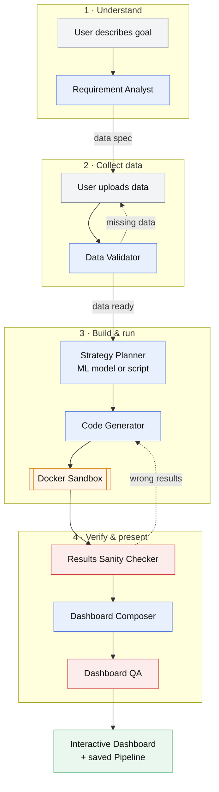
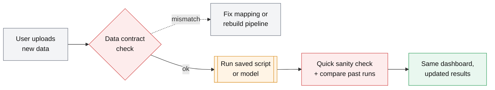
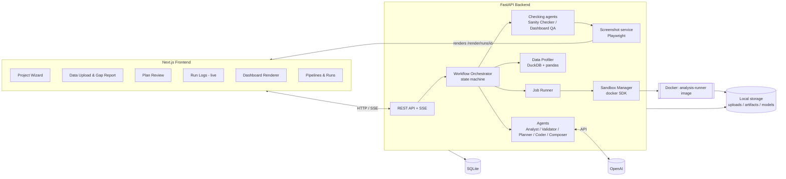

# Adaptive Data Analysis Platform — Project Plan

> A domain-agnostic tool: the user describes what they want to learn, an LLM tells them what data it needs, an agent validates the data, then the system either **trains an ML model** or **generates a Python analysis script** (run in a Docker sandbox), and shows the results in an **interactive dashboard**. The model/script is saved as a reusable **Pipeline**, so the user can upload new data of the same shape later and get updated results.

## High-Level Flow

### First run



### Repeat runs (the main purpose)



**Legend:** grey = user · blue = LLM agent · red = checking agent · orange = code execution · green = output. Dotted arrows are loops back for fixes. No LLM is needed for repeat runs unless a check flags something.

---

## 1. Decisions (v1)

| Area | Choice | Why |
|---|---|---|
| Backend | **FastAPI** (Python 3.12) | Same language as the analysis/ML code; async; Pydantic. |
| Frontend | **Next.js 15** (App Router, TypeScript) | Your choice; good for dashboards. |
| LLM | **OpenAI** (structured outputs + tool calling) | Your choice. Wrapped behind a small `LLMClient` interface so it can be swapped later. |
| Data types | **Tabular only**: CSV, Excel, Parquet, JSON | v1 scope. |
| Sandbox | **Docker containers** per run | Self-hosted, network-off, resource-limited. |
| Scale | **Personal / prototype**: single user, runs locally | SQLite, local file storage, minimal auth. |
| Data processing | pandas + DuckDB (profiling large files) | Fast profiling without loading everything in memory. |
| ML | scikit-learn, XGBoost/LightGBM, statsmodels, Prophet (optional) | Covers classification, regression, clustering, forecasting. |
| Charts | Plotly.js (via `react-plotly.js`) or Recharts | Plotly recommended: wider chart range, built-in interactivity. |
| UI kit | Tailwind CSS + shadcn/ui | Fast to build clean UI. |
| Dashboard QA | Playwright (headless Chromium) + OpenAI vision model | Screenshots the real dashboard and checks layout/readability. |
| Background jobs | In-process task runner (`asyncio` + DB job table) | Enough for one user; can upgrade to Redis + arq/Celery later. |

---

## 2. Core Concepts

These are the objects the whole system revolves around:

1. **Project** — one analysis goal (e.g. "predict monthly churn", "find which products drive returns").
2. **Requirement** — the user's natural-language description + clarifications.
3. **Data Spec** — what the LLM says it needs: required/optional columns, types, meaning, granularity, minimum rows, example rows. Shown to the user as a checklist and downloadable template CSV.
4. **Dataset Version** — each uploaded file, with its profile (schema, stats, nulls, sample).
5. **Data Contract** — the *frozen* schema after the first successful run (column names, types, allowed ranges/categories, column mapping). Every future upload is checked against it. **This is what makes re-runs safe.**
6. **Pipeline** — the reusable artifact: generated code + (for ML) trained model file + data contract + dashboard spec. Versioned.
7. **Run** — one execution of a pipeline on one dataset version, producing `results.json` + artifacts + logs.
8. **Dashboard Spec** — JSON describing widgets (KPIs, charts, tables) bound to keys in `results.json`. Generated once, reused for every run so updated data refreshes the same dashboard.

---

## 3. Workflow in Detail

### Stage 1 — Requirement Analysis
- User types a requirement (and optional context: domain, goal, time horizon).
- **Requirement Analyst** (OpenAI, structured output) returns:
  - `task_type` guess: `prediction | classification | forecasting | clustering | descriptive | statistical_test | other`
  - `clarifying_questions[]` (if the request is ambiguous) — answered in a short chat loop
  - `data_spec`: required columns, optional columns, types, description, example values, min rows, granularity (per-row = customer? transaction? day?)
  - `success_criteria`: what outputs the user will get
- UI shows the spec as a checklist + "Download template CSV".

### Stage 2 — Data Upload & Validation
- User uploads one or more files. Backend profiles them (DuckDB/pandas): columns, inferred types, null %, unique counts, min/max, sample rows. **Only the profile + a small sample goes to the LLM, never the full dataset.**
- **Data Validator Agent** (tool-calling agent) with tools like:
  - `get_profile()`, `get_sample(n)`, `column_stats(col)`, `value_counts(col)`, `check_join(file_a, file_b, key)`
- Agent output:
  - **Column mapping** (spec column → user column, e.g. `customer_id` ← `CustID`)
  - **Gap report**: missing required columns, wrong types, too many nulls, too few rows, date range too short, leakage risks
  - Status: `ready | needs_more_data | ready_with_warnings`
- If not ready → user sees what's missing and re-uploads / adds files / confirms mapping. Loop until ready.

### Stage 3 — Strategy Planning
- **Strategy Planner** decides **ML path vs Script path** and writes an analysis plan:
  - ML path: target column, features, model family, validation strategy (train/test split, time-based split for time series), metrics.
  - Script path: steps (cleaning, aggregations, statistical tests, segmentations), outputs.
- Plan is shown to the user for **approval / edit** before any code runs (cheap and avoids wasted runs).

### Stage 4 — Code Generation & Sandbox Execution
- **Code Generator** writes code to a fixed interface so it is reusable:
  ```python
  # Script path
  def run(input_dir: str, output_dir: str, params: dict) -> None: ...

  # ML path
  def train(input_dir, output_dir, params) -> None     # saves model.joblib + metrics
  def predict(input_dir, model_path, output_dir, params) -> None  # used on re-runs
  ```
- Code must write a `results.json` following a schema (see §7) + optional files (CSV tables, model).
- **Execute → observe → fix loop**: run in Docker; if it fails or `results.json` is invalid, feed the traceback back to the LLM to fix (max ~3–5 attempts).
- Static checks before running: AST scan for banned imports (`subprocess`, `socket`, `requests`, `os.system`…), size limits.

### Stage 4b — Results Sanity Check
A separate **Results Sanity Checker** agent reviews the results *before* the user sees them. It is separate from the Code Generator so it is not checking its own work. Full design in **§7a**.
- Pass → go on to the dashboard.
- Fail → send the issues back to the Code Generator for a fix (max 2 rounds).
- Still failing → show the dashboard anyway, with a clear warnings banner and the list of issues.

### Stage 5 — Dashboard
- **Dashboard Composer** reads `results.json` keys and produces a **Dashboard Spec** (JSON): layout grid + widgets.
- **Dashboard QA** agent then checks that the dashboard is properly aligned and readable, and sends fixes back to the Composer (full design in **§7b**).
- Next.js renders the spec with a fixed set of widget components — the LLM never writes React code, it only picks widgets and binds data.
- Widget types: `kpi`, `line`, `bar`, `scatter`, `histogram`, `heatmap`, `pie`, `table`, `feature_importance`, `confusion_matrix`, `forecast_with_interval`, `text_insight`.
- Interactivity: filters, hover tooltips, zoom, table sort/search, compare runs (run selector).
- LLM-written **narrative summary** ("Key insights") generated from `results.json`.

### Stage 6 — Repeat Runs (the main purpose)
- User opens a saved Pipeline → uploads new data.
- **Contract check (deterministic, no LLM)**: same columns (after mapping), compatible types, categories within known set (warn on new ones), no critical null spikes.
- **Drift check** (ML path): compare new data distributions vs training data (PSI / KS test) → warning if drifted.
- Execution:
  - Script path → re-run saved `run()` on new data.
  - ML path → user picks **Predict with existing model** or **Retrain on new (or combined) data**.
- **Quick sanity check**: the code-only checks from §7a, plus a comparison with previous runs. The LLM is called only if something is flagged.
- **Quick dashboard check**: the rule-based checks from §7b only (new data can bring longer labels or more categories). A screenshot review runs only if a rule fails.
- Same dashboard spec renders the new `results.json`. Runs are listed so the user can compare over time.
- If the contract check fails, offer: auto-map columns via LLM, or "fork pipeline" (go back to Stage 3).

---

## 4. System Architecture

> 🔍 **[Open the zoomable version](architecture.html)**: scroll to zoom, drag to move. If you edit the diagram below, update `architecture.html` too.



### Project state machine
```
DRAFT → REQUIREMENTS_READY → DATA_UPLOADED → DATA_VALIDATED
      → PLAN_PROPOSED → PLAN_APPROVED → RUNNING → COMPLETED (Pipeline saved)
                                              ↘ FAILED
COMPLETED → (new data) → RERUNNING → COMPLETED
```

---

## 5. Sandbox Design (Docker)

- One prebuilt image `analysis-runner:py3.12` with pinned libs: pandas, numpy, scipy, scikit-learn, xgboost, lightgbm, statsmodels, pyarrow, openpyxl, joblib (prophet optional).
- **No `pip install` at runtime** — code can only use preinstalled libs (the LLM is told the exact list).
- Per run, a new container with:
  - `network_mode="none"`
  - memory limit (e.g. 2 GB), CPU limit (e.g. 2 cores), `pids_limit`
  - timeout (e.g. 10 min), killed after
  - read-only root FS; `/input` mounted read-only, `/output` writable, `/code` read-only
  - non-root user, `no-new-privileges`, all capabilities dropped
- stdout/stderr streamed to the UI via SSE.
- A small `runner.py` inside the image imports the generated module, calls `run`/`train`/`predict`, and validates `results.json`.

---

## 6. Data Model (SQLite via SQLModel/SQLAlchemy)

| Table | Key fields |
|---|---|
| `projects` | id, name, status, requirement_text, created_at |
| `messages` | id, project_id, role, content (requirement clarification chat) |
| `data_specs` | id, project_id, spec_json, version |
| `datasets` | id, project_id, file_path, file_type, profile_json, uploaded_at |
| `validations` | id, project_id, dataset_ids, status, gap_report_json, column_mapping_json |
| `plans` | id, project_id, path (`ml`/`script`), plan_json, approved |
| `pipelines` | id, project_id, version, path, code_path, model_path, contract_json, dashboard_spec_json, active |
| `runs` | id, pipeline_id, dataset_ids, mode (`train`/`predict`/`script`), status, logs_path, results_path, metrics_json, started_at, finished_at |
| `llm_calls` | id, project_id, agent, prompt_tokens, completion_tokens, cost, latency (for debugging/cost tracking) |

Files on disk:
```
storage/
  projects/{project_id}/
    uploads/{dataset_id}.{ext}
    pipelines/v{n}/code.py, model.joblib, contract.json, dashboard.json
    runs/{run_id}/results.json, logs.txt, artifacts/
```

---

## 7. `results.json` Contract

All generated code must output this shape, so the dashboard and comparisons work for any domain:

```json
{
  "summary": { "title": "...", "rows_processed": 12000 },
  "kpis":   [ { "key": "churn_rate", "label": "Churn rate", "value": 0.12, "format": "percent" } ],
  "series": [ { "key": "monthly_revenue", "x": [...], "y": [...], "x_label": "Month", "y_label": "Revenue" } ],
  "tables": [ { "key": "top_segments", "columns": [...], "rows": [[...]] } ],
  "model":  { "type": "xgboost_classifier", "metrics": { "auc": 0.86 }, "feature_importance": [...] },
  "insights_raw": [ "Segment B has 3x higher churn" ]
}
```
Validated with a Pydantic model on the backend. The dashboard spec references items by `key`.

---

## 7a. Results Sanity Checker

**Goal:** catch results that run without errors but are wrong, misleading or don't answer the question.

It runs in three layers, cheapest first:

**Layer 1 — Code checks (no LLM, always run)**
| Check | Example |
|---|---|
| Row accounting | `rows_processed` matches input rows (minus documented drops). Flag if > 20% of rows were dropped silently. |
| Bad numbers | NaN, Infinity or empty values in KPIs, series or tables. |
| Range rules | Percentages within 0–100, shares add up to ~100%, counts not negative, probabilities within 0–1. |
| Date coverage | Output dates fall inside the input date range. Forecasts start after the last input date. |
| ML metrics too good | e.g. AUC > 0.98 or R² > 0.99 → possible **target leakage**. |
| ML metrics too bad | Model does no better than a simple baseline (majority class, mean, last value). |
| Statistical tests | Sample size big enough, p-values reported with the test name. |

**Layer 2 — Spot-check by recalculation (sandbox, no LLM)**
- A small, separate script recalculates 2–3 key numbers straight from the raw data with pandas (e.g. total revenue, row counts, a group mean) and compares them with `results.json`.
- These checks are generated once per pipeline, saved with it, and reused on every repeat run.

**Layer 3 — LLM review (first run, or when Layers 1–2 flag something)**
- Input: the requirement, the approved plan, the data profile, `results.json` and the Layer 1–2 findings. **Not** the raw data.
- Questions it answers:
  - Do the results actually answer the user's question?
  - Did the code follow the approved plan (right target, right split, right grouping)?
  - Are the written insights backed by the numbers?
  - Is anything implausible for this domain (e.g. average age 340)?

**Output** (structured):
```json
{
  "status": "pass | warn | fail",
  "issues": [
    { "severity": "high", "check": "target_leakage", "message": "AUC 0.995 – 'cancel_date' column is derived from the target", "suggested_fix": "Drop cancel_date from features" }
  ]
}
```
- `fail` → issues go back to the Code Generator (max 2 rounds), then shown as warnings if not fixed.
- `warn` → results shown with a warnings panel.
- The report is saved with each run and shown on the dashboard ("Checks: 14 passed, 1 warning").

**On repeat runs** — Layer 1 + Layer 2, plus a **comparison with past runs**:
- KPI jumps beyond a set limit (e.g. > 50% change from the previous run).
- ML metric drops (e.g. accuracy down > 5 points) → suggest retraining.
- The structure of `results.json` changed (keys missing).
- LLM review only if something is flagged.

---

## 7b. Dashboard QA Agent

**Goal:** make sure every dashboard is properly aligned, readable and not cluttered, for any data.

**Step 1 — Rule checks on the dashboard spec (code, instant)**
| Rule | Fix applied |
|---|---|
| Widgets overlap or leave gaps in the grid | Re-pack layout |
| Too many series in one chart (> 8) | Keep top N, group the rest as "Other" |
| Pie/donut with > 6 slices | Switch to bar chart |
| Category labels too long (> 20 characters) | Truncate with full text on hover, or make it a horizontal bar |
| Missing title, axis labels or units | Ask the Composer to add them |
| Numbers not formatted (e.g. `0.123456`) | Apply `percent` / `currency` / `compact` format |
| Empty widget (no data) | Remove it |
| Table too wide (> 8 columns) | Hide extra columns behind a column picker |
| Too many widgets above the fold | Move details to a second tab |

**Step 2 — Screenshot review (vision model)**
- The backend opens a print-only page (`/render/runs/{id}`) in a **headless browser (Playwright)** and takes screenshots at **desktop (1440 px)** and **mobile (390 px)** widths, in **light and dark mode**.
- Code checks on the real rendered page: elements overflowing their card, text cut off, overlapping labels, text too small (< 11 px), low colour contrast (WCAG AA).
- An OpenAI vision model reviews the screenshots and returns issues tied to widget IDs, e.g. *"x-axis dates overlap on widget `revenue_trend`"*.

**Step 3 — Fix loop**
- Issues go back to the Dashboard Composer, which edits the **spec** (not code), then QA runs again. Max 2 rounds.
- The final screenshot is saved as the run's thumbnail on the project list.

**Note:** most problems are prevented up front. The widget components themselves handle label rotation, responsive sizing, number formatting and colour palettes. The QA agent catches what is left.

---

## 8. API Endpoints (FastAPI)

```
POST   /projects                          create project with requirement
GET    /projects / /projects/{id}
POST   /projects/{id}/messages            answer clarifying questions
GET    /projects/{id}/data-spec           + /template.csv
POST   /projects/{id}/datasets            upload file(s)
POST   /projects/{id}/validate            run Data Validator agent
PUT    /projects/{id}/column-mapping      user corrects mapping
POST   /projects/{id}/plan                generate plan
POST   /projects/{id}/plan/approve        approve (optionally edited) plan → starts run
GET    /runs/{id}                         status, metrics
GET    /runs/{id}/logs/stream             SSE live logs
GET    /runs/{id}/results                 results.json
GET    /pipelines/{id}                    code, contract, dashboard spec
POST   /pipelines/{id}/runs               new data → contract check → run (predict | retrain | script)
GET    /pipelines/{id}/runs               run history for comparison
```

---

## 9. Agents & Prompts

| Agent | Input | Output (Pydantic / structured output) | Tools |
|---|---|---|---|
| Requirement Analyst | requirement + chat | `RequirementAnalysis` (task_type, questions, data_spec) | – |
| Data Validator | data_spec + profiles + samples | `ValidationReport` (status, mapping, gaps, warnings) | profile/sample/stats/join tools |
| Strategy Planner | spec + validation + profile | `AnalysisPlan` (path, steps, target, metrics) | – |
| Code Generator | plan + profile + lib list + interface | Python source | `run_in_sandbox` (fix loop) |
| Results Sanity Checker | requirement + plan + profile + results.json + check findings | `SanityReport` | `run_spot_check` (sandbox) |
| Dashboard Composer | results.json keys + plan (+ QA issues) | `DashboardSpec` | – |
| Dashboard QA | dashboard spec + screenshots + rule findings | `DashboardQAReport` | `render_screenshot` (Playwright) |
| Insight Writer | results.json | markdown summary | – |

Notes:
- Use OpenAI **structured outputs** (JSON schema from Pydantic) for every non-code agent.
- Keep prompts in `backend/app/agents/prompts/*.md`, versioned.
- Log every LLM call (tokens, cost) to `llm_calls`.
- **Privacy**: only send schema, stats and ≤ 20 sample rows to OpenAI; make the sample size configurable.

---

## 10. Folder Structure

```
P1/
├── backend/
│   ├── app/
│   │   ├── main.py
│   │   ├── api/              # routers: projects, datasets, plans, runs, pipelines
│   │   ├── core/             # config, logging, db session
│   │   ├── models/           # SQLModel tables
│   │   ├── schemas/          # Pydantic: DataSpec, ValidationReport, AnalysisPlan, Results, DashboardSpec
│   │   ├── agents/           # analyst.py, validator.py, planner.py, coder.py, sanity.py,
│   │   │                     # composer.py, dashboard_qa.py, prompts/
│   │   ├── checks/           # sanity_rules.py, dashboard_rules.py, run_compare.py (code-only checks)
│   │   ├── llm/              # LLMClient interface + OpenAI implementation
│   │   ├── services/         # profiler.py, contract.py, drift.py, orchestrator.py, jobs.py,
│   │   │                     # screenshot.py (Playwright)
│   │   └── sandbox/          # manager.py (docker SDK), static_check.py
│   ├── tests/
│   └── pyproject.toml
├── sandbox-image/
│   ├── Dockerfile
│   ├── requirements.txt
│   └── runner.py
├── frontend/
│   ├── app/
│   │   ├── page.tsx                      # project list
│   │   ├── projects/new/page.tsx         # requirement wizard
│   │   ├── projects/[id]/data/page.tsx   # spec checklist, upload, gap report
│   │   ├── projects/[id]/plan/page.tsx   # plan review
│   │   ├── projects/[id]/run/page.tsx    # live logs
│   │   ├── projects/[id]/dashboard/page.tsx
│   │   ├── render/runs/[id]/page.tsx     # bare dashboard page for QA screenshots
│   │   └── pipelines/[id]/page.tsx       # upload new data, run history
│   ├── components/dashboard/            # KpiCard, LineChart, Table, ... + SpecRenderer
│   └── lib/api.ts                       # typed client (generated from FastAPI OpenAPI)
├── storage/                             # gitignored
├── docker-compose.yml                   # backend + frontend (sandbox via host docker socket)
└── PLAN.md
```

---

## 11. Milestones

| Phase | Goal | Deliverables | Est. |
|---|---|---|---|
| **0. Setup** | Skeleton | FastAPI + Next.js scaffolds, SQLite, docker-compose, OpenAI client, typed API client generation | 2–3 days |
| **1. Requirements** | Stage 1 end-to-end | Requirement chat, Data Spec UI, template CSV | 3–4 days |
| **2. Data & Validation** | Stage 2 | Upload, profiler, Validator agent, gap report, column-mapping UI | 4–5 days |
| **3. Sandbox + Script path** | First real results | Docker image, sandbox manager, planner, code generator with fix loop, `results.json` validation, live logs | 5–7 days |
| **4. Dashboard** | Stage 5 | Dashboard Composer, widget library, spec renderer, insights text | 4–5 days |
| **4b. Quality agents** | Trustworthy output | Results Sanity Checker (3 layers), Dashboard QA (rules + Playwright screenshots + vision review), fix loops, warnings UI | 5–6 days |
| **5. Pipelines & Re-runs** | Main purpose | Save pipeline, data contract, contract check, re-run, quick checks, comparison with past runs, run history | 4–5 days |
| **6. ML path** | Models | train/predict interface, model saving, metrics widgets, drift check, leakage/baseline checks, retrain option | 5–7 days |
| **7. Hardening** | Reliability | Static code checks, timeouts, error UX, tests, eval set of ~10 sample datasets/requirements | ongoing |

> Build the **script path first** (Phases 3–5): it proves the whole loop including re-runs; the ML path then reuses the same sandbox, contract and dashboard.

---

## 12. Testing Strategy

- **Unit**: profiler, contract checker, drift, `results.json` validation, static code checker.
- **Agent evals**: a folder of test cases (requirement + dataset + expected task type / required columns). Run after every prompt change and track pass rate.
- **Sanity checker tests**: datasets with planted problems (target leakage, a dropped half of the rows, wrong totals) must be caught.
- **Dashboard QA tests**: specs with planted layout problems (overlaps, 20-slice pie, 60-character labels) must be flagged and fixed.
- **Sandbox tests**: malicious code (network calls, fork bombs, file writes outside `/output`) must fail safely.
- **E2E**: Playwright for the main flow on a sample dataset (e.g. sales CSV → forecast dashboard → re-run with next month's data).

---

## 13. Risks & Mitigations

| Risk | Mitigation |
|---|---|
| LLM generates wrong or buggy analysis | Plan approval step, fix loop, fixed output schema, Results Sanity Checker, user can view code |
| Code that "works" but is statistically wrong (e.g. leakage) | Planner prompt rules (time-based splits, no target in features), sanity checks for leakage and baselines, recalculation spot-checks |
| Sanity checker is too strict and blocks good results | Only `fail` triggers a fix; after 2 rounds results are always shown with warnings; thresholds are configurable |
| Screenshot QA is slow or flaky | Rule checks first; screenshots only on first run or when a rule fails; QA failure never blocks the dashboard |
| Re-run data differs subtly | Strict data contract + drift warnings |
| Sandbox escape / harmful code | Docker hardening (§5), AST checks, no network |
| Large files | DuckDB profiling, size limit in v1 (e.g. 200 MB), sampling for LLM |
| OpenAI cost | Re-runs use no LLM; log tokens; use a smaller model for simple agents |
| Dashboard looks generic or messy | Curated widget set + Composer picks best charts + Dashboard QA; user can edit/hide widgets |

---

## 14. Future (post-v1)

- Database connectors (Postgres/MySQL) and scheduled re-runs (e.g. "refresh every Monday").
- Multi-user auth, workspaces, Redis job queue, S3 storage.
- Text/document and image data.
- User edits to the dashboard layout, export to PDF, shareable links.
- "Chat with your results" — ask follow-up questions on a finished run.
- Provider-agnostic LLM layer (Claude, local models).

---

## 15. Open Questions (answer when convenient)

1. **Multiple files per project?** e.g. `customers.csv` + `orders.csv` that must be joined — support in v1 or single file only?
2. **Re-run data mode**: should a new upload *replace* the old data, or be *appended* to it (e.g. adding a new month to history)?
3. **Code visibility**: should the user be able to view/edit the generated Python code, or keep it hidden?
4. **ML retraining**: on new data, automatically retrain, or always ask the user?
5. **Max file size** you expect for v1?
6. **Deployment**: only on your machine, or should it later run on a server/cloud?
